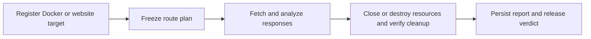

  

<h1 align="center">SEIRETH</h1>

Authorized security checks. Disposable environments. Verified cleanup.

  
  
  
  

  
  

SEIRETH is a local, single-operator GUI and API for passive HTTP header and cookie
security checks. Assess an existing website or a disposable Docker application
with declared companion services. Route plans record response expectations,
coverage, evidence, and a strict release verdict in PostgreSQL 18.
SEIRETH verifies cleanup after execution.
Finished assessments can be downloaded as versioned JSON or self-contained HTML
with findings, remediation, validated evidence, and cleanup status.

## How it works

Targets bound requests by project, origin, and path. Choose routes and plugins;
runtime references supply authentication. Docker bundles use an internal network,
owned volumes, and pinned local images. Website connections validate and pin
destination addresses while preserving Host and TLS identity.
See [Docker and website workflows](docs/workflows.md) for reproducible examples.

## Checks

| Workflow                                                                            | Checks                                                                                      |
| ----------------------------------------------------------------------------------- | ------------------------------------------------------------------------------------------- |
| [CI](https://github.com/seireth/seireth/actions/workflows/ci.yml)                   | Repository checks, Python quality, Frontend quality, Dependency review (pull requests only) |
| [Build](https://github.com/seireth/seireth/actions/workflows/build.yml)             | Tests, coverage and SonarQube                                                               |
| [Integration](https://github.com/seireth/seireth/actions/workflows/integration.yml) | Docker assessment lifecycle, including browser and packaged-asset checks                    |

## Getting started

Follow [Getting started](docs/getting-started.md) for setup and startup commands.
Website checks run natively; Docker checks require prepared images and access to
the Docker socket. Both workflows request real target responses.
Open `/dashboard/`
on the API address to use the GUI.

## Documentation

| Guide                                      | Purpose                                            |
| ------------------------------------------ | -------------------------------------------------- |
| [Getting started](docs/getting-started.md) | Run, verify, stop, and troubleshoot                |
| [Configuration](docs/configuration.md)     | Required settings, defaults, and Compose overrides |
| [Assessments](docs/assessments.md)         | Submit requests and interpret results              |
| [Docker and website workflows](docs/workflows.md) | Configure staging, service bundles, route coverage, and release gates |
| [Architecture](docs/architecture.md)       | Understand execution, persistence, and recovery    |
| [Plugin development](docs/plugins.md)      | Add approved checks                                |
| [Security model](docs/security-model.md)   | Understand boundaries and investigate cleanup      |
| [Roadmap](docs/roadmap.md)                 | Future priorities and directions                   |
| [Contributing](CONTRIBUTING.md)            | Develop, test, and change schemas                  |

Use only authorized targets. Report vulnerabilities through [SECURITY.md](SECURITY.md).
Licensed under [Apache 2.0](LICENSE).
